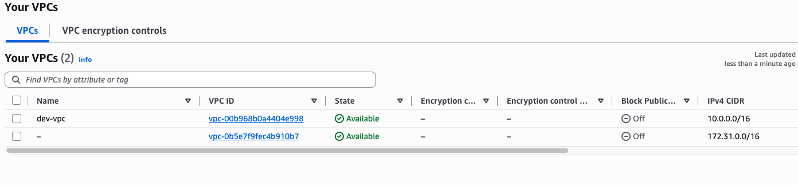
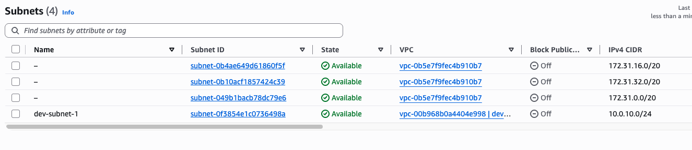
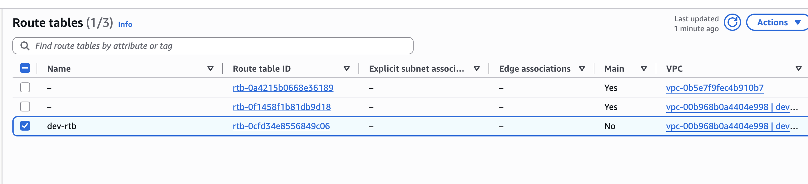
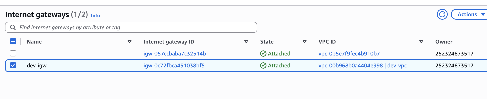
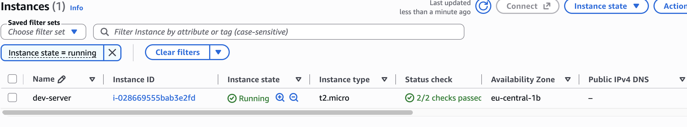
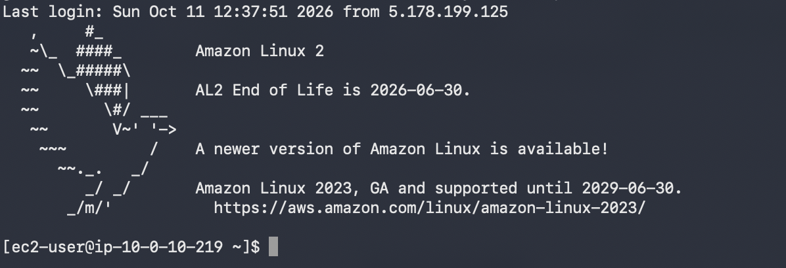
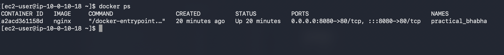
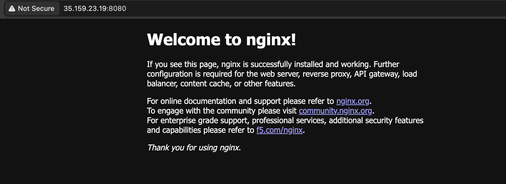

# Module 12 — Demo 1: Automate AWS Infrastructure with Terraform

## Technologies Used
* **Terraform** (Infrastructure as Code)
* **Amazon Web Services (AWS)** (VPC, Subnet, Internet Gateway, Route Table, EC2, Security Groups)
* **Docker** (Container runtime for Nginx)
* **Linux** (Amazon Linux 2)
* **Git** (Version Control)

---

## Project Description
* Created a complete Terraform configuration project to automate the provisioning of core AWS networking infrastructure, including a Custom VPC, Subnets, Route Tables, and an Internet Gateway.
* Configured dynamic security groups to handle incoming secure shell traffic (`SSH`) and application ports (`8080`).
* Utilized AWS Data Sources to automatically fetch the latest Amazon Linux 2 AMI.
* Automated the deployment of an EC2 instance with a custom user data script (`entry-script.sh`) to bootstrap and run an Nginx Docker container.

---

## Key Concepts
* **Infrastructure as Code (IaC):** Declarative provisioning of cloud infrastructure using Terraform state files and execution plans.
* **VPC Networking:** Establishing isolated network boundaries with custom CIDR blocks, public subnets, and internet gateways.
* **Data Sources:** Querying AWS dynamically at runtime (e.g., retrieving the latest AMI ID without hardcoding).
* **Cloud Bootstrapping:** Using EC2 `user_data` to automate software installation (Docker + Nginx) upon instance startup.

---

## Architecture Diagram

```text
 +---------------------------------------------------------------+
 |                        AWS Region                             |
 |                                                               |
 |  +---------------------------------------------------------+  |
 |  |                        Custom VPC                       |  |
 |  |                     (10.0.0.0/16)                       |  |
 |  |                                                         |  |
 |  |  +-------------------------+    +--------------------+  |  |
 |  |  |      Internet Gateway   |<-->|    Route Table     |  |  |
 |  |  +-------------------------+    +--------------------+  |  |
 |  |               ^                           ^             |  |
 |  |               |                           |             |  |
 |  |               v                           v             |  |
 |  |  +---------------------------------------------------+  |  |
 |  |  |                    Public Subnet                  |  |  |
 |  |  |                   (10.0.10.0/24)                  |  |  |
 |  |  |                                                   |  |  |
 |  |  |  +---------------------------------------------+  |  |  |
 |  |  |  |                 EC2 Instance                |  |  |  |
 |  |  |  |               (Amazon Linux 2)              |  |  |  |
 |  |  |  |                                             |  |  |  |
 |  |  |  |  +---------------------------------------+  |  |  |  |
 |  |  |  |  |      Docker Container (Nginx)         |  |  |  |  |
 |  |  |  |  |        Port 8080 -> Port 80           |  |  |  |  |
 |  |  |  |  +---------------------------------------+  |  |  |  |
 |  |  |  +---------------------------------------------+  |  |  |
 |  |  +---------------------------------------------------+  |  |
 |  +---------------------------------------------------------+  |
 +---------------------------------------------------------------+

```

---

## Step-by-Step Implementation

### Step 1: Initialize and Create Custom VPC

* Defined the AWS provider and created a custom VPC resource block with a `10.0.0.0/16` CIDR block.
* Ran `terraform apply` to provision the VPC.

📸 **Screenshot 1** — Custom VPC successfully created in the AWS console


### Step 2: Configure Subnets

* Added a public subnet resource linked to the custom VPC.

📸 **Screenshot 2** — Subnets created and mapped correctly


### Step 3: Setup Internet Gateway & Route Tables

* Created an Internet Gateway and a custom Route Table pointing traffic from `0.0.0.0/0` to the Internet Gateway, then associated it with the subnet.

📸 **Screenshot 3** — Route tables configured


📸 **Screenshot 4** — Internet Gateway attached


### Step 4: Provision EC2 Instance & Security Groups

* Configured security groups allowing inbound traffic on port `22` (restricted to my IP) and port `8080` (publicly accessible).
* Provisioned an Amazon Linux 2 instance using a dynamic AMI data source and injected a user data script to run Nginx.

📸 **Screenshot 5** — EC2 instance `dev-server` running successfully


### Step 5: Verify SSH Connectivity & Docker Deployment

* Connected to the instance via SSH using the generated key pair.
* Checked running Docker containers to verify Nginx deployed successfully.

📸 **Screenshot 6** — Successful SSH connection into the EC2 instance


📸 **Screenshot 7** — `docker ps` confirming Nginx container is running on port 8080


### Step 6: Access Application in Browser

* Navigated to the public IP address on port `8080` via a web browser.

📸 **Screenshot 8** — Nginx welcome page loading successfully


---

## What I Learned

* How to use Terraform to declaratively provision complex cloud topologies (VPC, subnets, gateways, and routing rules).
* How to query dynamic values like the latest AWS AMIs using data sources instead of hardcoding image IDs.
* Automating instance configuration and software deployment seamlessly via `user_data` execution scripts.

---

## Cleanup

To destroy all provisioned resources and avoid incurring AWS costs, run:

```bash
terraform destroy

```

---

## Screenshots Table

| Filename | Caption |
| --- | --- |
| `screenshot-01.png` | Custom VPC created in AWS console |
| `screenshot-02.png` | Subnets configured in custom VPC |
| `screenshot-03.png` | Route tables associated with the VPC |
| `screenshot-04.png` | Internet Gateway attached to the VPC |
| `screenshot-05.png` | EC2 Instance running in the AWS console |
| `screenshot-06.png` | Successful SSH session into the EC2 instance |
| `screenshot-07.png` | `docker ps` verification showing active Nginx container |
| `screenshot-08.png` | Nginx welcome web page accessed via browser |

```

```