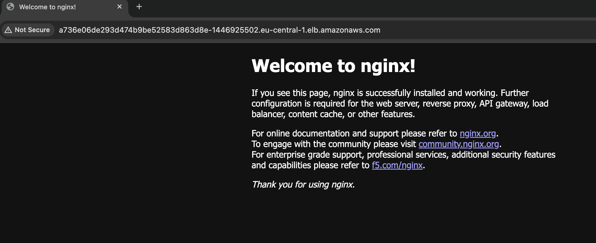

# Module 12 — Demo 3: Terraform & AWS EKS

## Technologies Used
* **Terraform** (Infrastructure as Code)
* **Amazon EKS (Elastic Kubernetes Service)** (Managed Kubernetes Control Plane & Node Groups)
* **Amazon Web Services (AWS)** (VPC, Subnets, Internet Gateways, IAM Roles, Security Groups)
* **kubectl** (Kubernetes command-line client)
* **Kubernetes Manifests** (`nginx.yaml` Deployment and Service)
* **Linux** (Environment orchestration)
* **Git** (Version Control)

---

## Project Description
* Automated the provisioning of an enterprise-grade Amazon EKS (Elastic Kubernetes Service) cluster using Terraform.
* Configured foundational networking requirements via dedicated configuration (`vpc.tf`) with public/private subnets and route tables suitable for Kubernetes node allocation.
* Defined IAM roles, security policies, and EKS cluster control plane infrastructure using `eks-cluster.tf`.
* Established provider definitions and backend configurations in `providers.tf` to manage authentication and cloud provider interactions.
* Connected `kubectl` to the newly created cluster and deployed an nginx application using `nginx.yaml`, confirming that the application deployment ran successfully on the cluster.

---

## Key Concepts
* **Managed Kubernetes Control Plane:** Provisioning an AWS EKS cluster to manage containerized workloads without handling control plane nodes manually.
* **Modular Configuration Files:** Separating concerns cleanly across distinct infrastructure files (`providers.tf`, `vpc.tf`, `eks-cluster.tf`).
* **IAM Integration for EKS:** Setting up necessary AWS Identity and Access Management (IAM) service roles and policies required for EKS clusters and worker node groups to communicate securely.
* **Cluster Networking:** Establishing multi-subnet VPC topologies to ensure highly available Kubernetes node placement.
* **Kubeconfig Authentication:** Using the AWS CLI to generate a kubeconfig entry so `kubectl` can authenticate against the EKS control plane with the same IAM identity used to create the cluster.
* **Declarative Deployments:** Describing the desired nginx Deployment and Service in a YAML manifest and letting Kubernetes reconcile the cluster to match it.

---

## Architecture Diagram

```
 +-----------------------------------------------------------------------+
 |                            Root Terraform                             |
 |                                                                       |
 |   +-------------------+    +--------------------------------------+   |
 |   |    providers.tf   |    |               vpc.tf                 |   |
 |   |                   |    |                                      |   |
 |   | - AWS Provider    |    | - Custom VPC                         |   |
 |   | - Version Locks   |    | - Public & Private Subnets           |   |
 |   +-------------------+    | - Internet Gateway & Route Tables    |   |
 |             |              +--------------------------------------+   |
 |             |                                  |                      |
 |             +-----------------+----------------+                      |
 |                               |                                       |
 |                               v                                       |
 |               +-------------------------------+                       |
 |               |        eks-cluster.tf         |                       |
 |               |                               |                       |
 |               | - EKS Cluster Control Plane   |                       |
 |               | - IAM Roles & Security Groups |                       |
 |               | - EKS Node Groups             |                       |
 |               +-------------------------------+                       |
 +-----------------------------------------------------------------------+
                               |
                               | kubectl (via kubeconfig)
                               v
 +-----------------------------------------------------------------------+
 |                         EKS Cluster Workloads                         |
 |                                                                       |
 |   nginx.yaml  ──►  Deployment (nginx pods)  ──►  Service (exposes app)|
 +-----------------------------------------------------------------------+
```

---

## Step-by-Step Implementation

### Step 1: Configure Providers
* Created `providers.tf` to declare the AWS provider, define required version constraints, and target the desired region.

### Step 2: Provision Network Infrastructure
* Implemented `vpc.tf` to configure the VPC, Internet Gateway, route tables, and subnets necessary for the EKS cluster nodes and control plane communication.

### Step 3: Deploy EKS Cluster & Node Groups
* Created `eks-cluster.tf` to provision the EKS cluster, attach required IAM roles for cluster operations, and define worker node groups.
* Executed `terraform init` to download required providers, followed by `terraform plan` and `terraform apply` to provision the cluster.

### Step 4: Connect kubectl to the EKS Cluster
* Generated a kubeconfig entry for the new cluster using the AWS CLI:

```bash
aws eks update-kubeconfig --region <region> --name <cluster-name>
```

* Verified the connection by confirming the worker nodes are visible to `kubectl`:

```bash
kubectl config current-context
kubectl get nodes
```

### Step 5: Deploy nginx Using nginx.yaml
* Applied the nginx manifest to the cluster:

```bash
kubectl apply -f nginx.yaml
```

* Checked that the Deployment, pods, and Service were created and running:

```bash
kubectl get deployments
kubectl get pods
kubectl get svc
```

### Step 6: Verify the Application Deployment
* Confirmed the nginx pods reached the `Running` state and the application deployment completed successfully.
* Accessed the application through the exposed Service endpoint to confirm it was serving traffic.
📸 **Screenshot 2**: nginx running in the browser at the AWS ELB DNS name (`http://<elb-dns-name>`) for the `demo-cluster` LoadBalancer Service, confirming that traffic reaches the nginx pods through the load balancer.

---

## What I Learned
* How to define and deploy a managed Kubernetes control plane on AWS using Terraform.
* How to manage complex dependencies between custom networking topologies (`vpc.tf`) and container orchestration layers (`eks-cluster.tf`).
* How to handle IAM permissions and security group configurations required for secure EKS cluster communication.
* How to connect `kubectl` to an EKS cluster with `aws eks update-kubeconfig` and verify cluster access with `kubectl get nodes`.
* How to apply a Kubernetes manifest with `kubectl apply -f` and verify its rollout with `kubectl get deployments`, `kubectl get pods`, and `kubectl get svc`.

---

## Cleanup
Delete Kubernetes workloads first. Services of type `LoadBalancer` create AWS load balancers outside Terraform's state, and leaving them in place can block VPC deletion:

```bash
kubectl delete -f nginx.yaml
```

Then destroy all provisioned EKS and AWS networking resources to avoid ongoing charges:

```bash
terraform destroy
```