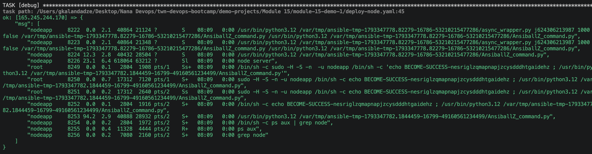

# Ansible: Deploy a Node.js Application

An Ansible playbook that prepares a fresh Ubuntu droplet and deploys a Node.js app on it. It runs in three plays:

| Play | What it does |
|------|--------------|
| Install node and npm | Updates the apt cache and installs `nodejs` and `npm` |
| Create new linux user for node app | Creates the `nodeapp` user |
| Deploy nodejs app | As `nodeapp`: copies and unpacks the app archive, installs dependencies, starts the app, and verifies that it is running |

**Note:** The app is started as a background process. It will not restart after a reboot.

## Setup

1. Create a droplet on DigitalOcean (Ubuntu) and add your SSH key. Note its public IP.

2. Put the app archive `nodejs-app-1.0.0.tgz` in the same folder as the playbook.

3. Put the droplet IP in the `hosts` file together with the connection details:

```text
165.245.244.170 ansible_user=root ansible_ssh_private_key_file=~/.ssh/id_rsa
```

4. Check that Ansible can reach the droplet:

```bash
ansible all -i hosts -m ping
```

## Running

```bash
ansible-playbook -i hosts deploy-node.yaml
```

The playbook runs once and exits. The app keeps running on the droplet.

Open `http://165.245.244.170:3000` in the browser to see the app. Port 3000 must be open in the droplet's firewall.

## Configuration

Droplet IP (`deploy-node.yaml` and `hosts`). It is set in all three plays:

```yaml
hosts: 165.245.244.170
```

Linux user that runs the app:

```yaml
name: nodeapp
become_user: nodeapp
```

The archive on your machine, copied to the droplet and unpacked:

```yaml
src: nodejs-app-1.0.0.tgz
dest: /home/nodeapp
```

Where dependencies are installed and the app is started from:

```yaml
path: /home/nodeapp/package
chdir: /home/nodeapp/package/app
```

The `async: 1000` and `poll: 0` settings on the start task let the playbook continue without waiting for `node server` to exit.

## Example Output

Each task is reported while the playbook runs:

```text
PLAY [Install node and npm] ***********************************
TASK [Update apt repo and cache] ******************************
TASK [Install nodejs and npm] *********************************

PLAY [Create new linux user for node app] *********************
TASK [Create linux user] **************************************

PLAY [Deploy nodejs app] **************************************
TASK [Unpack the nodejs file] *********************************
TASK [Install dependencies] ***********************************
TASK [Start the application] **********************************
TASK [Ensure app is running] **********************************
TASK [debug] **************************************************
```

The `debug` task prints the output of `ps aux | grep node`. A line with `node server` means the app is running.

The final summary shows `failed=0` and `unreachable=0` for the droplet:

```text
PLAY RECAP ****************************************************
165.245.244.170            : ok=11   changed=4    unreachable=0    failed=0    skipped=0    rescued=0    ignored=0
```

📸 `screenshot-01` — Output
   

## Cleanup

- Destroy the droplet in the DigitalOcean console
- Remove the IP from `hosts` and `deploy-node.yaml`