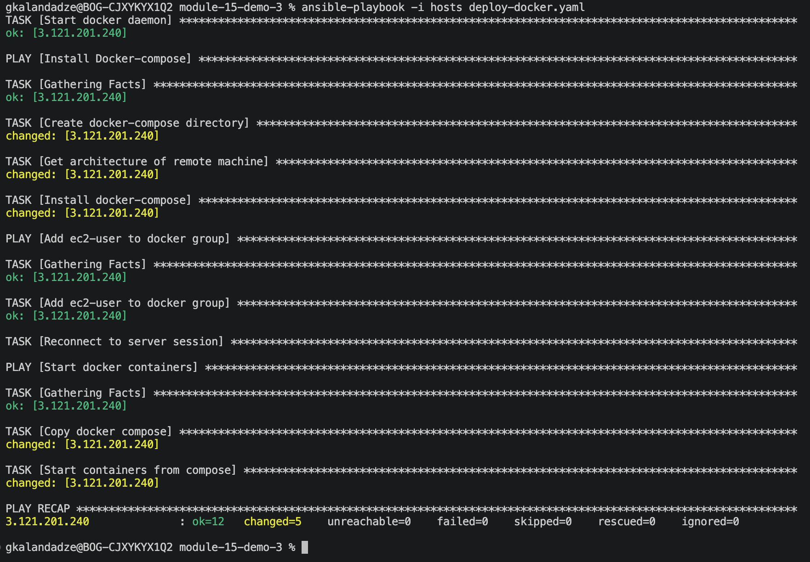
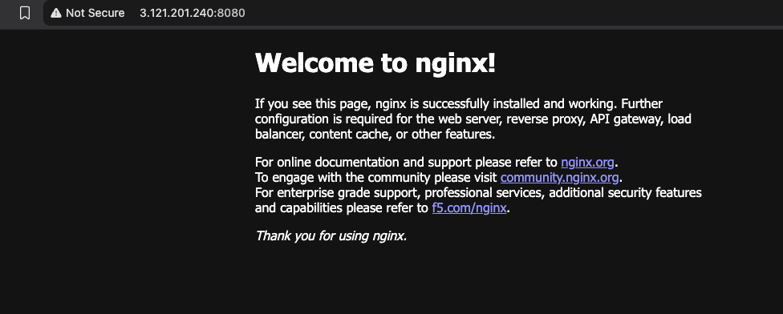

# Ansible & Docker: Deploy a Docker Compose App to EC2

Terraform creates an AWS EC2 instance. An Ansible playbook then installs Docker and Docker Compose on it, copies the `docker-compose.yaml` file that sits next to the playbook to the server, logs in to Docker Hub and starts the containers defined in it. The app is a simple nginx page served from an image on Docker Hub.

| Part | What it does |
|------|--------------|
| `terraform/main.tf` | Creates an EC2 instance (Amazon Linux 2023) and a security group that allows SSH (22) and HTTP (80) |
| Install Docker | Installs Docker with `yum` and starts the Docker daemon |
| Install Docker-compose | Downloads the Docker Compose plugin that matches the server's architecture |
| Add ec2-user to docker group | Lets `ec2-user` run Docker without `sudo` and reconnects the session so the change takes effect |
| Start docker containers | Copies `docker-compose.yaml` to the server, logs in to Docker Hub and starts the containers |

**Note:** The playbook needs your Docker Hub password or access token. Keep it in `project-vars`, which is excluded from git.

## Setup

1. Build the image and push it to Docker Hub. Build it for `linux/amd64` so it runs on the EC2 instance, even if your computer uses an ARM chip:

```bash
cd app
docker login
docker buildx build --platform linux/amd64 -t kala24/nginx-app:1.0 --push .
```

2. Create the EC2 instance. You need AWS credentials configured and an existing EC2 key pair in `eu-central-1`:

```bash
cd terraform
terraform init
terraform apply -var key_name=<KEY_NAME>
```

Terraform prints the `public_ip` of the new instance.

3. Put the instance IP and the path to your key in the `hosts` file:

```text
[docker_server]
<EC2_PUBLIC_IP> ansible_user=ec2-user ansible_ssh_private_key_file=~/.ssh/<KEY_NAME>
```

Connect once by hand and type `yes`, so the server's key is saved:

```bash
ssh -i ~/.ssh/<KEY_NAME> ec2-user@<EC2_PUBLIC_IP>
```

4. Create `project-vars` from the example and add your Docker Hub password or access token:

```bash
cp project-vars.example project-vars
```

```text
docker_password: <DOCKERHUB_PASSWORD_OR_ACCESS_TOKEN>
```

5. Check that Ansible can reach the instance:

```bash
ansible all -i hosts -m ping
```

## Running

Run the playbook from the folder that contains `deploy-docker.yaml` and `docker-compose.yaml`:

```bash
ansible-playbook -i hosts deploy-docker.yaml
```

The playbook runs once and exits. The containers keep running on the instance.

Open `http://<EC2_PUBLIC_IP>` in the browser to see the nginx page.

To check the container on the server:

```bash
ssh -i ~/.ssh/<KEY_NAME> ec2-user@<EC2_PUBLIC_IP>
docker ps
```

## Configuration

Image that is started (`docker-compose.yaml`):

```yaml
services:
  nginx-app:
    image: kala24/nginx-app:1.0
    ports:
      - "80:80"
    restart: always
```

The copy task takes the file from the playbook's folder and puts it in the home directory of `ec2-user`:

```yaml
src: docker-compose.yaml
dest: /home/ec2-user/docker-compose.yaml
```

Docker Hub user and password (`deploy-docker.yaml`):

```yaml
username: kala24
password: "{{ docker_password }}"
```

Instance size, region and open ports (`terraform/main.tf`):

```hcl
region        = "eu-central-1"
instance_type = "t3.micro"
```

SSH is open to `0.0.0.0/0` by default. To limit it to your own address, pass `-var ssh_cidr=<YOUR_IP>/32` to `terraform apply`.

The Docker Compose plugin is downloaded for the server's architecture, which the playbook reads with `uname -m` on the server.

If the image is public on Docker Hub, the `Docker login` task is not needed and `project-vars` can be removed.


`docker ps` on the server shows the `nginx-app` container running with port `80` mapped.

📸 `screenshot-01` — Output
   

📸 `screenshot-02` — App is running
    

## Cleanup

```bash
cd terraform
terraform destroy -var key_name=<KEY_NAME>
```

- Delete the image from Docker Hub if you no longer need it
- Revoke the Docker Hub access token if you created one for this demo